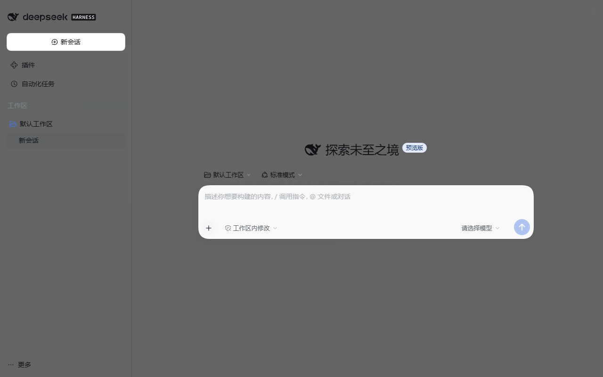

# dsh-glaze

给你的 **DeepSeek Harness** 换一张自己的壁纸，并让整个界面透过一层真实的磨砂玻璃。

> glaze 是「给器物上一层玻璃釉」。壁纸不是被一张半透明色块盖住，而是**从玻璃里透出来**。



## 特点

- **自定义背景图** — PNG / JPEG / WebP / GIF / AVIF / BMP / SVG，单张最大 32 MB，只存在本机
- **真毛玻璃** — 整个窗口一张 `backdrop-filter` 磨砂层，不是把底色调淡
- **毛玻璃开关** — 不想要模糊就关掉，退化为纯半透明底色，更省、也不会出现模糊接缝
- **界面不透明度** — 0–100% 全行程可调，背景图透出多少由你决定
- **背景模糊 / 明暗遮罩 / 整体压暗** — 亮色或高对比壁纸也能保证文字可读
- **填充方式 / 对齐位置** — 铺满、完整显示、原始尺寸、平铺
- **实时预览** — 设置页里直接看到叠加效果
- **跟随主题** — 切换亮色 / 暗色时，玻璃色调与遮罩自动适配
- **本机持久化** — 设置写入 profile，重启后依然生效

## 安装

### 方式一：从插件管家安装（推荐）

如果你的 DeepSeek Harness 版本带有插件管家 / 插件市场，直接搜索 **dsh-glaze** 安装，
然后重启 Harness。

### 方式二：手动装进 profile

```powershell
$profile = "$env:USERPROFILE\.dsh\profiles\desktop"

# 1) 装包
cd $profile
npm install dsh-glaze --save-exact

# 2) 把包加进 bundle 列表
node -e "const fs=require('fs');const p='package.json';const pkg=JSON.parse(fs.readFileSync(p,'utf8'));if(!pkg.dsh.profile.bundles.includes('dsh-glaze'))pkg.dsh.profile.bundles.push('dsh-glaze');fs.writeFileSync(p,JSON.stringify(pkg,null,2)+'\n')"

# 3) 重启 Harness
```

`cordis.patch.yml` 里的配置行由包自带的 patch 自动插入，不需要手写。

## 使用

设置 → **外观**：

| 项目 | 说明 |
|---|---|
| 启用外观 | 总开关。关闭后界面完全恢复原样 |
| 毛玻璃效果 | 真模糊开关。关闭则只保留半透明底色 |
| 背景图 | 上传 / 替换 / 移除 |
| 界面不透明度 | 越高越接近原版外观，越低壁纸越明显 |
| 背景模糊 | 模糊半径，越大细节越少、文字越清楚 |
| 背景明暗遮罩 | 用主题色压一层，提亮或压暗壁纸 |
| 整体压暗 | 独立的黑色遮罩，适合高亮壁纸 |
| 填充方式 / 对齐位置 | 壁纸的铺法 |

## 说明

- 壁纸**只保存在本机**（`$DSH_HOME/dsh-glaze/`），不会上传到任何服务器。
- 插件自带的 HTTP 路由有浏览器信任围栏（仅接受 loopback / 受信来源），这不是认证。
- 需要 Chromium 111+ / Firefox 113+（`color-mix`）。桌面端自带 Electron，满足要求。

## 许可

MIT
