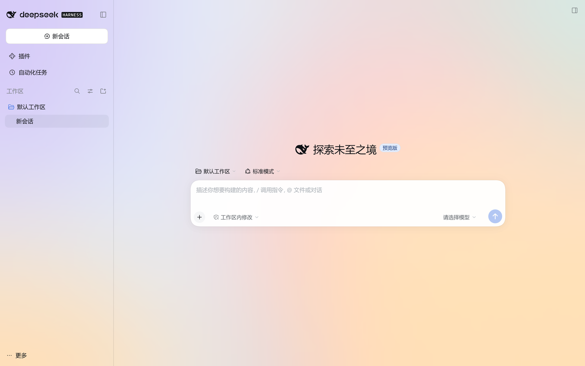
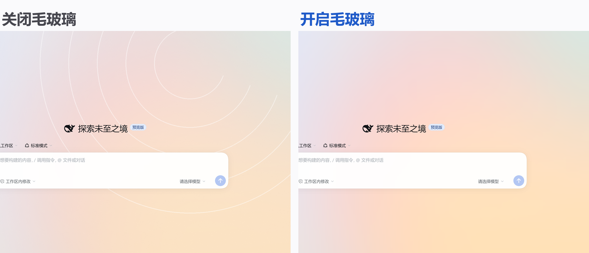
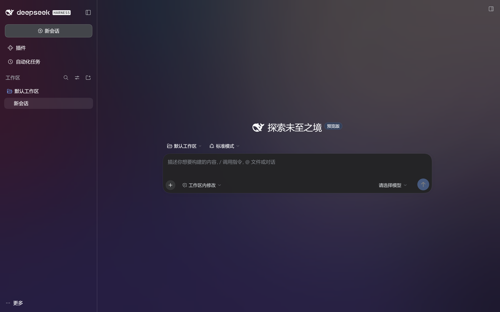
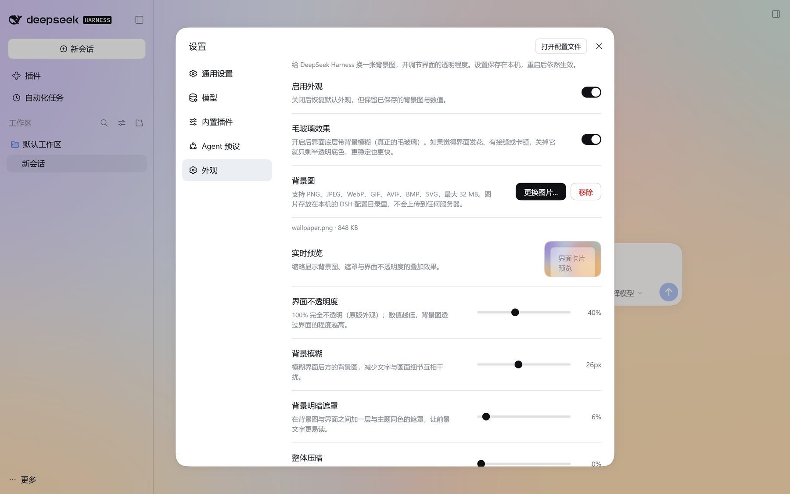
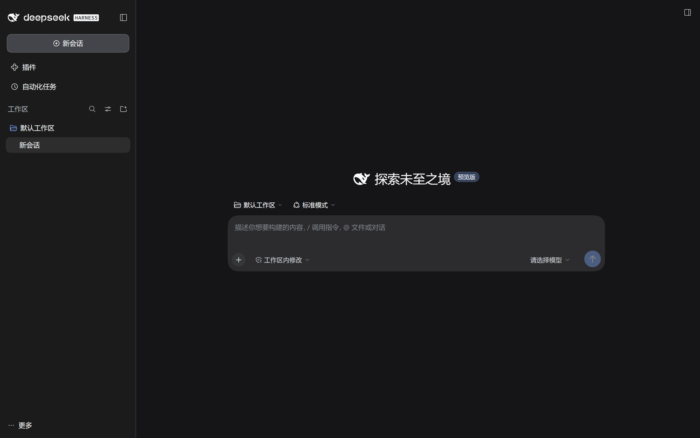

# 我用 DeepSeek Harness，给 DeepSeek Harness 写了个外观插件

> 标题备选：
> 1. 我用 DeepSeek Harness，给 DeepSeek Harness 写了个外观插件
> 2. 全程 DeepSeek-V4.1-Flash：让它给 Harness 自己换一套玻璃皮肤
> 3. 用 Harness 写 Harness：一个「自己改自己」的皮肤插件

---

这件事有点绕：**我用来写插件的东西，就是这个插件要装进去的东西。**

过去这些天，我在 DeepSeek Harness 里开了一个会话，跟它说「我想换个壁纸、界面能不能透一点」，然后一路迭代到能发布。模型全程是 **DeepSeek-V4.1-Flash**，没有换过。

我做的是提需求、看效果、指出哪里不对；它负责写代码、跑测试、截图自查。最后出来的东西叫 **dsh-glaze**。



## 一、起因很朴素

每天用 Harness 写代码，界面是同一块白底。不是功能不够，就是想好看一点。

我先试了常见的做法：把背景色调半透明。结果很难看——那不叫通透，叫「蒙了层脏塑料膜」。我想要的其实是**壁纸从一层玻璃后面透出来**。

于是有了这个需求：铺一张壁纸，前面盖一层真的磨砂玻璃，字要清楚，壁纸要看得见。

## 二、它和「调透明度」不是一回事

关键差别在这张图里：



左边能看清壁纸上的同心圆弧，右边只剩柔光。**模糊是浏览器真的做了 `backdrop-filter`**，不是画上去的色块。

正因为它是滤镜（有性能代价），我坚持留了个开关：不想模糊就关掉，退化成纯半透明底色，更省也更快。

## 三、中间踩的坑，比想象中多

这部分我觉得比功能介绍更有意思——**每一个坑都是我看出来的，改是它改的**。

**① 壁纸死活不显示。**

调了半天透明度，壁纸就是不出现。查下来是两个原因叠加：壁纸当时放在 `z-index:-1` 的独立图层上，而 `backdrop-filter` 采样的是「元素下面已绘制的像素」，那个图层根本不在采样范围里；同时外壳自己还画了一层不透明底色，把壁纸盖得死死的。

改法：壁纸改成 `<body>` 自己的背景，进入页面绘制顺序，正好在内容层下面。

**② 插件整个没加载，界面比原版还丑。**

有一次改完，效果突然变得很差。控制台里一行字：`import failed: data is not defined`。

原因是 CSS 的模板字符串里，我在注释中手滑写了一个反引号，把字符串提前闭合了，后面整个样式表被当成 JavaScript 解析。`node --check` 查不出这种问题——语法完全合法，一加载就炸。

后来专门加了一个冒烟测试：用最小 React/DOM 桩，真的把插件跑一遍。这个检查后来又拦住我两次。

**③ 关掉毛玻璃，重启又自己开了。**

这其实是两个 bug。一个是我自己的维护脚本把配置覆盖了；更隐蔽的是，插件启动时只读了一次配置——而那一刻配置表还没就绪，读取**静默失败**，于是用了默认值，之后再也不重试。

改法：订阅配置表 + 启动后有限重试。

**④ 侧边栏偶尔变回原样。**

这个最阴。清底色的逻辑是「判断这个容器背景是否不透明」——可一旦清掉，它算出来就是透明的，于是下一轮判断「不需要清」，把规则删了，它又变回不透明。**判断条件把自己算了进去**，形成自我引用循环。

最后改成只看几何、不看颜色，并且规则按结构位置生成而不是往 DOM 上打标记——因为 React 重新渲染会覆写 `className`。

## 四、深色也一起做了

切换主题时，玻璃色调和遮罩会跟着换，不需要配两套：



## 五、能调什么

设置里就一个「外观」页面：



- **背景图** — PNG / JPEG / WebP / GIF / AVIF / BMP / SVG，单张最大 32 MB
- **界面不透明度** — 0–100%，100% 就是原版外观
- **背景模糊** — 0–60px
- **背景明暗遮罩 / 整体压暗** — 亮色、高对比的图也能看清字
- **填充方式 / 对齐位置** — 铺满、完整显示、原始尺寸、平铺
- **实时预览** — 右上角当场看到叠加效果

底部输入框下面那行统计（轮次 / token / 缓存命中）我也顺手收成了一个小胶囊——不然它悬在玻璃上，特别像被人忘在那儿的文字。

## 六、不想用了，关掉就干净

这条我做得比较较真：**关掉总开关，界面必须完全恢复原样**，不能留半点半透明或者被清空的底色。



不是把透明度调到 100%，而是把插件加的东西——玻璃层、遮罩、清底规则、壁纸——全部拆掉。壁纸和数值留着，下次打开还在。

## 七、怎么装

开源，MIT，代码在 GitHub：

**https://github.com/Yue-Zeyi/dsh-glaze**

**① 插件管理里填地址**

```
https://github.com/Yue-Zeyi/dsh-glaze
```

**② 手动装进 profile**

```powershell
cd "$env:USERPROFILE\.dsh\profiles\desktop"
npm install github:Yue-Zeyi/dsh-glaze --save-exact
```

然后把 `dsh-glaze` 加进 `package.json` 里 `dsh.profile.bundles` 数组，重启 Harness。

装完都要**重启一次**，设置页才会出现「外观」。

## 八、几点说明

- **壁纸只在你本机**（`$DSH_HOME/dsh-glaze/`），不会上传到任何服务器。
- **第三方插件，与 DeepSeek 官方无关。**
- 需要 Chromium 111+ / Firefox 113+（用到了 `color-mix`），桌面端自带的 Electron 满足。

## 最后

回头看，这件事本身比插件更有意思：**一个工具好用到了可以拿去改它自己。**

我没有写一行 CSS，也不知道 `backdrop-filter` 的采样规则——我只是每天看着不顺眼，然后一条条告诉它哪里不对。剩下的，包括那些我自己根本想不到的自我引用 bug，都是它查出来、改掉的。

插件已经发布了，欢迎试用，也欢迎告诉我哪里还能更好：

**https://github.com/Yue-Zeyi/dsh-glaze**

---

*本文提到的 dsh-glaze 为 MIT 许可开源项目，与 DeepSeek 官方无关。*
